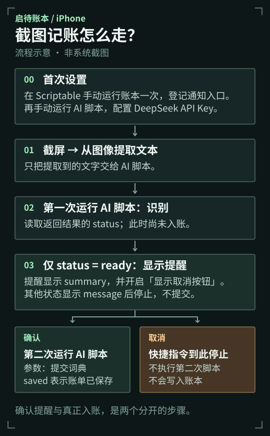
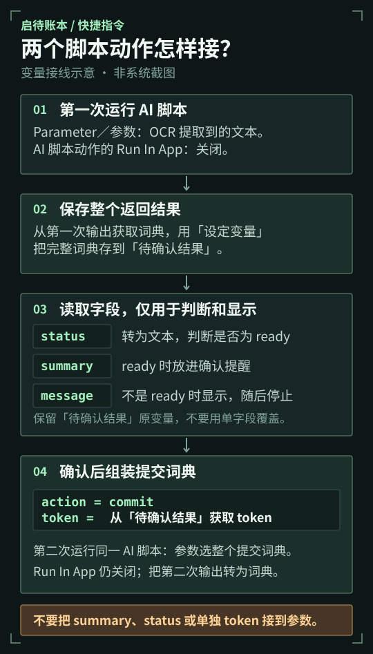

# Scriptable 截图记账

基于 iOS 快捷指令和 Scriptable 的截图记账工具，支持 AI 识别、手动确认和分类统计。

在 iPhone 上把一张交易详情截图变成一笔账单：快捷指令截屏并提取文字，DeepSeek 识别，**你确认后才保存**。账本在 Scriptable 中查看，支持手动记账、账户、预算和分类统计。GitHub 只存代码，不会自动更新手机里的脚本。

## 先选版本

| 你想做什么 | 使用哪个脚本 |
| --- | --- |
| 从零搭建截图 → AI → 确认 → 入账 | 同时安装[账本 v2.2.0](scriptable/icloud-backup/Qidai-Ledger-v2.2.0.js)和 [DeepSeek AI v1.3.0](scriptable/icloud-backup/Qidai-DeepSeek-AI-v1.3.0.js)。这是仓库中成对归档的版本，**iCloud 自动备份默认关闭**，不必开启也可使用。 |
| 手动记账，或维护已有的本地版 | 使用[本地账本 v2.1.4](scriptable/local/Qidai-Ledger-v2.1.4.js)或[像素主题版](scriptable/local/Qidai-Ledger-v2.1.4-pixel.js)，二选一。像素版只改界面样式。已有本地 AI 工作流时，先保留原有 AI 脚本；早期的 AI v1.2.3 未归档，不能从本仓库复原整套旧版组合。 |

v2.1.4 是包含分类图引线和分类明细更新的独立本地版；v2.2.0 是更早交付的可选 iCloud 备份方案，不是 v2.1.4 的直接升级。不要据版本号推断功能，也不要同时运行多个账本版本。更换已有脚本前先备份，修改原脚本内容但保留 Scriptable 中的脚本名称，避免现有快捷指令或通知入口失效。

## 1. 在 iPhone 上安装脚本

1. 安装 [Scriptable（App Store）](https://apps.apple.com/cn/app/scriptable/id1405459188) 和 Apple 的「快捷指令」。在 iPhone 上打开上表链接，点 **Raw**，复制脚本的全部文本。
2. 打开 Scriptable，点 **＋**，分别建立「启待账本」和「DeepSeek 记账」，粘贴各自的完整代码、保存。只使用手动记账时，仅需账本脚本。
3. **在 Scriptable 中直接运行「启待账本」一次**。这会打开账本，并登记当前脚本名称对应的通知入口。若另做一个「打开账本」快捷指令，选择账本脚本并开启 **Run In App**。下文识别和保存用的 AI 动作恰好相反，两个都应关闭 **Run In App**。
4. 从 [DeepSeek 开放平台](https://platform.deepseek.com/api_keys)获取 API Key。在 **Scriptable App 内直接运行**「DeepSeek 记账」，选「配置 DeepSeek API」，粘贴 Key，填写你的账号可用的模型 ID 后保存。脚本预填 `deepseek-flash`；若接口提示模型不存在或无权限，在同一菜单改为账号可用的模型。保存配置不会调用 API。
5. 如需入账通知，确认 iPhone「设置 → 通知 → Scriptable」允许通知。账本脚本改名后，再直接运行新名称的账本一次。

## 2. 搭建「截图记账」快捷指令

### 识别：第一次运行脚本

| 顺序 | 快捷指令动作 | 设置 |
| --- | --- | --- |
| 1 | **截屏** | 在已完成的交易详情页触发。 |
| 2 | **从图像提取文本** | 图像选第 1 步输出的「截屏」。 |
| 3 | **Scriptable → Run Script** | 脚本选 **DeepSeek 记账**；**Parameter = 第 2 步输出的文本**；关闭 **Run In App**。 |
| 4 | **从输入中获取词典** | 输入选第 3 步 Run Script 的输出。 |
| 5 | **设定变量** | 名称填 **待确认结果**，值用第 4 步整个词典。 |
| 6 | **获取词典值** | 词典选「待确认结果」，键填 `status`。 |
| 7 | **文本** | 只插入第 6 步输出的蓝色变量，不手打「词典值」。 |
| 8 | **如果** | 选第 7 步「文本」，条件「是」，值手动填 `ready`。 |

iOS 版本不同，动作名称可能略有差异，例如「词典」也可能显示为「字典」。若「如果」里只看到「有任何值／没有任何值」，先检查第 7 步是否把 `status` 转成了文本，并确认第 8 步用的不是整个词典。

### 确认与保存：第二次运行脚本

以下动作放在 **「如果」与「否则」之间**，不要放到「结束如果」之后。

| 顺序 | 快捷指令动作 | 设置 |
| --- | --- | --- |
| 9 | **获取词典值** | 从「待确认结果」取 `summary`。 |
| 10 | **显示提醒** | 标题填「确认记账？」；信息填第 9 步输出；打开 **显示取消按钮**。点「取消」停止，不执行下一步。 |
| 11 | **获取词典值** | 从「待确认结果」取 `token`。 |
| 12 | **词典** | 建两项文本：`action` = 手打 `commit`；`token` = 插入第 11 步的蓝色变量。 |
| 13 | **Scriptable → Run Script** | 仍选 **DeepSeek 记账**；**Parameter = 第 12 步整个词典**；关闭 **Run In App**。 |
| 14 | **从输入中获取词典** | 输入选第 13 步、即**第二次** Run Script 的输出。 |
| 15 | **设定变量** | 命名为 **保存结果**，值选第 14 步词典。 |
| 16 | **查看保存结果** | 可从「保存结果」取 `status` 和 `message`。若状态不是 `saved`，用「显示提醒」显示 `message`。若为 `saved` 但 `notificationScheduled` 为假，可显示「已保存」和 `notificationError`，不用重试。 |

在 **「否则」与「结束如果」之间**，用「获取词典值」从「待确认结果」取 `message`，再用「显示提醒」显示。这个分支不执行第二次脚本。

如果 Run Script 菜单还有「运行时显示」，可一并关闭。第一次只向 DeepSeek 识别并生成待确认草稿，没有新增账单；第二次提交才写盘，不会再发 DeepSeek 请求。**不要把 OCR 文本、`summary` 或提醒动作输出传给第二次 Run Script。**

## 3. 验证与排查

先用不含真实付款信息的测试输入。找不到「截屏」动作时，首次可用「选择照片」选一张测试截图替代第 1 步，OCR 输入跟着选择照片的输出。点「取消」应不新增；点确认后在账本检查金额、类别和数量。若入账通知出现，点击后应打开 Scriptable 对应账单。这里依赖 iOS 和 Scriptable 的权限及运行环境，未经你在设备上测试，不要据通知判断是否写入。

| 现象 | 检查哪里 |
| --- | --- |
| 提示 `Alerts are not supported in Siri`，或识别时跳进 Scriptable | 两个 AI Run Script 都关闭 Run In App；确认框用快捷指令自己的「显示提醒」。API Key 配置单独在 Scriptable App 内完成。 |
| 最后只显示「等待确认，尚未写入账本」 | 读到了第一次的「待确认结果」。检查第二次 Parameter 是否接提交词典，反馈是否从第二次输出的「保存结果」取值。 |
| 提示确认凭据过期或者已处理 | 草稿 20 分钟过期；重新从截图识别开始。先看账本，避免把已保存误当失败重试。 |
| 已记账却没通知，或点通知没开详情 | 看第二次输出的 `status`、`notificationScheduled`、`notificationError`，并检查通知权限。打开正确的账本脚本一次刷新通知入口。通知失败不等于保存失败。脚本会尝试发有详情入口的通知，不必再加一条快捷指令「显示通知」。 |
| Run Script 无输出或不能转成词典 | 先在 Scriptable 直接运行账本，确认能正常打开；再检查 AI 脚本是否完整、Parameter 是否接对。不要把报错当成 token，也不要为排查而删除旧账本。 |
| AI 不识别 | 使用一张明确显示一笔已完成交易的详情截图，检查 OCR 是否为空、API Key／模型是否可用。不要用余额页、失败或未支付页面。 |

## 进阶：脚本接口、数据和隐私

- 第一次 **Parameter** 可传 OCR 字符串，或词典 `{"action":"prepare","text":"OCR 文字"}`。首次成功识别返回 `status: "ready"`、`token`、`summary`、`details`、`message`。其他结果可能是 `duplicate` 或 `error`，没有可提交草稿。
- 第二次接受 `{"action":"commit","token":"第一次的 token"}`，也接受原样的整个 `ready` 词典。脚本可解析这些带 `action` 或 `status:"ready"` 的 JSON 文本；只有 token 不够。用 `{"action":"cancel","token":"…"}` 可主动丢弃草稿；上面的普通取消路径直接停止，无需加第三次脚本动作。
- 只有 `status: "saved"` 表示已写入。入账后 AI 尝试发 Scriptable 本地通知，把 `recordId` 加进账本脚本的打开链接。通知是另一步，`notificationScheduled: true` 也只是已安排，不保证系统展示。
- 数据在 **Scriptable 的本机 Documents 目录**：`qidai-ledger-v2.json`（账本）、`qidai-ledger-backups/`（本机备份）、`qidai-ledger-ui.json`（通知入口）、`qidai-ai-pending.json`（短期确认草稿）、`qidai-deepseek-config.json`（模型设置）。API Key 在 Scriptable 钥匙串，不在 JSON 或代码里。旧 `qidai-ledger-v1.json` 只用于迁移，升级后继续操作旧版不会同步进新版。
- v2.2.0 开启 iCloud 备份后，封存于 Scriptable 的 iCloud Documents 下 `Qidai-Ledger-Backups/<设备标识>/`；每设备最多 30 份。它是备份，不是实时多设备同步。恢复前先本机导出；不要拿真实账本做首次恢复测试。
- AI 会把 **OCR 文本、当天日期、可选分类及账户名称**发给 DeepSeek。不会上传截图原图或历史账本；但截图中的姓名、订单号等如果被识别成文字，也会随 OCR 上传。API 可能产生费用。不要把 API Key、真实账单、截图、备份或运行数据提交到 GitHub。

更多：[维护说明](docs/maintenance.md) · [像素主题说明](docs/pixel-theme.md)

操作参考：[Apple：创建自定义快捷指令](https://support.apple.com/zh-cn/guide/shortcuts/-apd84c576f8c/ios) · [Apple：使用变量](https://support.apple.com/zh-hans/guide/shortcuts/apdd02c2780c/ios) · [Apple：显示提醒](https://support.apple.com/zh-cn/guide/shortcuts/-apd081d9d61f/ios) · [Scriptable：脚本参数](https://docs.scriptable.app/args/#shortcutparameter) · [Scriptable：脚本输出](https://docs.scriptable.app/script/#setshortcutoutput)。
